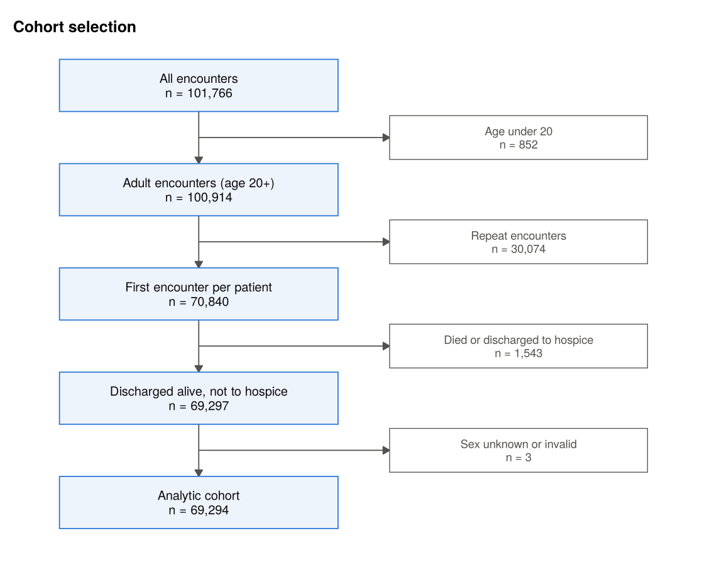
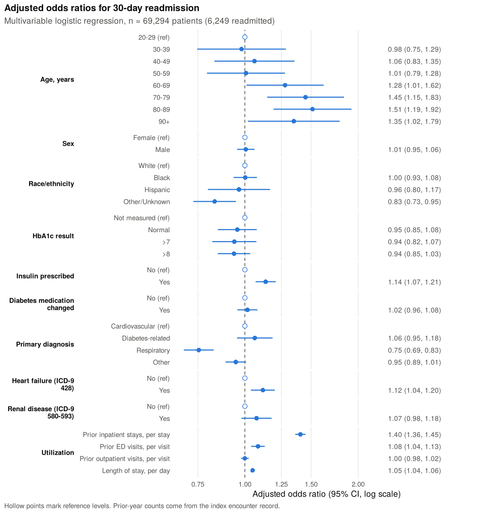
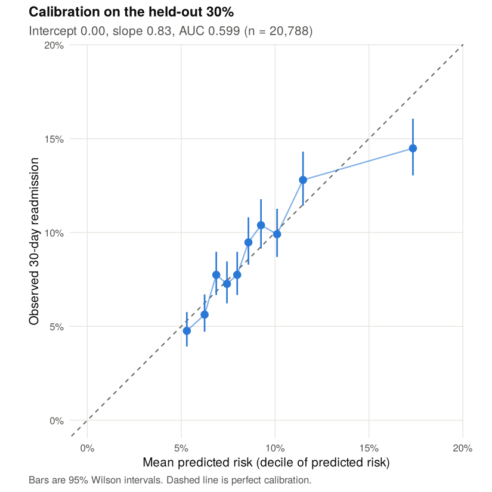

# 30-Day Readmission Among Adults Hospitalized with Diabetes

Which demographic, clinical and utilization factors are associated with 30-day readmission in 69,294 adults hospitalized with diabetes at 130 US hospitals, and how well do they predict it?

[](https://github.com/rmali0/diabetes-readmission-30day/actions/workflows/ci.yml)

[](LICENSE)

## Question and why it matters

A readmission within 30 days of discharge often means something went wrong in the hand-off home: medications, follow-up, or a condition that was not stable yet. Medicare's Hospital Readmissions Reduction Program ties hospital payment to 30-day readmission for conditions such as heart failure and pneumonia, which are common reasons people with diabetes are admitted. We asked which patient factors recorded during a routine admission are associated with early readmission, and whether a simple, interpretable model built from those fields can tell high-risk patients apart.

## Data

- **Diabetes 130-US Hospitals for Years 1999-2008** (UCI Machine Learning Repository), 101,766 inpatient encounters from 130 US hospitals and delivery networks, drawn from the Cerner Health Facts database.
- License: CC BY 4.0. Citation: Strack B, DeShazo JP, Gennings C, et al. Impact of HbA1c measurement on hospital readmission rates: analysis of 70,000 clinical database patient records. *BioMed Research International*. 2014;2014:781670.
- The gzipped file (3 MB) is committed in [`data/`](data/), so the analysis runs from a fresh clone. See [`data/README.md`](data/README.md) for provenance and coding notes.

## Approach

- **Cohort:** adults (20+), each patient's first encounter as the index stay, and index stays ending in death or hospice discharge removed, since those patients cannot be readmitted (the approach of Strack et al.).
- **Outcome:** readmitted in under 30 days (`<30`) vs not (`>30` or `NO`).
- **Predictors (13):** age band, sex, race/ethnicity, HbA1c result, insulin, diabetes medication change, primary diagnosis group (ICD-9: 250.xx diabetes, 390-459 and 785 circulatory, 460-519 and 786 respiratory), heart failure (428) and renal disease (580-593) in any of the three diagnosis fields, prior-year inpatient, emergency and outpatient visits, and length of stay.
- **Analysis:** Table 1 by readmission status; chi-square and Mann-Whitney tests with effect sizes; multivariable logistic regression with GVIF and per-predictor likelihood ratio tests; discrimination (AUC with DeLong CI) and calibration (plot, intercept, slope) on a held-out 30%, plus bootstrap optimism correction (200 resamples) on the full cohort; a sensitivity analysis using the original course cohort definition.

## Key results

All numbers below come from `Rscript run_all.R` on the committed data.



Of 69,294 patients in the analytic cohort, **6,249 (9.0%) were readmitted within 30 days**. Removing the 1,543 index stays that ended in death or hospice raised the rate slightly from 8.8% in the course cohort.



| Predictor | Adjusted OR (95% CI) | LR chi-square (df) |
|:--|:--|:--|
| Prior inpatient stays, per stay | 1.40 (1.36 to 1.45) | 394.1 (1) |
| Age 80-89 vs 20-29 | 1.51 (1.19 to 1.92) | 124.0 (7) for age |
| Length of stay, per day | 1.05 (1.04 to 1.06) | 112.0 (1) |
| Respiratory vs cardiovascular primary diagnosis | 0.75 (0.69 to 0.83) | 45.3 (3) for diagnosis group |
| Insulin prescribed | 1.14 (1.07 to 1.21) | 16.3 (1) |
| Prior emergency visits, per visit | 1.08 (1.04 to 1.13) | 14.2 (1) |
| Heart failure | 1.12 (1.04 to 1.20) | 8.6 (1) |

Sex, HbA1c result, medication change, renal disease and prior outpatient visits were not associated with readmission after adjustment. Full tables are in [`outputs/tables/`](outputs/tables/) and the rendered notebook is [`analysis/readmission_analysis.md`](analysis/readmission_analysis.md).

**Discrimination is modest.** On the held-out 30% (20,788 patients) the AUC was **0.599 (95% CI 0.586 to 0.612)**. The bootstrap optimism-corrected AUC on the full cohort was **0.605** (apparent 0.609), so overfitting is minimal; these fields simply do not carry much signal. Calibration-in-the-large was good (intercept -0.005; mean predicted risk 9.1% vs observed 9.0%). The held-out calibration slope was 0.83 (95% CI 0.72 to 0.94), driven by the top decile, where the model predicted 17.3% and 14.5% were readmitted. The bootstrap-corrected slope was 0.97.



**Sensitivity analysis.** Refitting on the original course cohort (70,837 patients, 8.8% readmitted) reproduced the submitted estimates exactly (prior inpatient stays OR 1.401, 95% CI 1.358 to 1.446). Moving to the corrected cohort changed no conclusion. The largest shift was age 90+ (OR 1.26 to 1.35, now with a CI above 1), which fits with the 90+ group having the highest share of index stays ending in death or hospice (7.4%, vs under 1% below age 60), patients who could not be readmitted. See [`outputs/figures/sensitivity_odds_ratios.png`](outputs/figures/sensitivity_odds_ratios.png).

### Clinical interpretation

Prior inpatient use was by far the strongest signal. The crude 30-day readmission rate was 8.2% for patients with no admission in the prior year, 12.9% with one, 18.5% with two and 35.3% with five or more. Only 12% of patients had any prior admission, yet they accounted for 20% of readmissions. That field is already in the record at discharge, so it is a cheap first screen for who gets a scheduled follow-up call, an early clinic appointment and careful medication reconciliation before leaving. Insulin use and heart failure point the same way: these are plausibly the patients for whom a missed dose adjustment or a fluid shift turns into a return visit. What the model cannot do is pick out individual patients reliably. With an AUC near 0.60 it ranks a readmitted patient above a non-readmitted one only about 60% of the time, so it is better suited to describing risk groups than to triaging single discharges.

## Limitations

- **Old data.** Encounters are from 1999-2008, before the readmission penalty program and today's discharge and diabetes care practices. Rates and associations may differ now.
- **ICD-9 and encounter-level coding.** Diagnoses are ICD-9, and only three diagnosis fields are recorded per encounter, so heart failure and renal disease are undercounted. Diabetic kidney disease coded only as 250.4x is not captured by the 580-593 flag.
- **Missing context.** No social determinants, insurance detail, frailty, discharge follow-up, or labs beyond HbA1c (not measured in about 82% of patients). These are likely large parts of the unexplained risk.
- **Outcome definition.** Readmissions to hospitals outside the database are likely missed, planned and unplanned readmissions cannot be separated, and "first encounter" assumes `encounter_id` increases with time.
- **Model form.** The count variables and length of stay are entered as linear terms, as in the course model. The Box-Tidwell style check shows curvature for prior inpatient stays and length of stay, which is consistent with the overprediction in the top risk decile.
- **Single dataset.** There is no external validation; the held-out split and bootstrap are internal checks only.

## How to run

Requires R (4.3 tested) and these packages: `broom`, `car`, `dplyr`, `ggplot2`, `knitr`, `pROC`, `readr`, `rmarkdown`, `scales`, `tibble`, `tidyr`, `testthat`. Pandoc is needed to render the notebook (it ships with RStudio).

```sh
git clone https://github.com/rmali0/diabetes-readmission-30day.git
cd diabetes-readmission-30day
make all          # unit tests, then the full analysis
```

Without `make`: `Rscript tests/testthat.R` then `Rscript run_all.R`. The full run took about 4 minutes on 2 cores, most of it the 200 bootstrap refits; `BOOT_REPS=20 Rscript run_all.R` gives a quick check run.

## Repository layout

```
diabetes-readmission-30day/
├── R/
│   ├── cohort.R        # read data, inclusion/exclusion steps, cohort flow counts
│   ├── recode.R        # outcome, age, race, HbA1c, ICD-9 groups and comorbidity flags
│   ├── labels.R        # display labels shared by tables and figures
│   ├── table1.R        # Table 1 and bivariate tests with effect sizes
│   ├── model.R         # logistic model, ORs, LR tests, VIF, validation, bootstrap
│   └── plots.R         # cohort flow, forest, ROC, calibration, sensitivity figures
├── analysis/
│   ├── readmission_analysis.Rmd
│   └── readmission_analysis.md     # rendered, viewable on GitHub
├── data/
│   ├── diabetic_data.csv.gz
│   └── README.md
├── outputs/
│   ├── figures/        # PNG figures used above
│   └── tables/         # CSV tables (cohort flow, Table 1, ORs, performance, ...)
├── tests/
│   ├── testthat.R
│   └── testthat/       # cohort and recoding tests on a 10-row fixture
├── .github/workflows/ci.yml
├── DESCRIPTION         # dependency list for CI
├── Makefile
├── run_all.R
└── LICENSE
```

## Course context and what changed

This project began as a partner final project for HDS-5310 Analytics and Statistical Programming at Saint Louis University (Spring 2026), written by Richard Mali and Vivian Asare. The research question, variable definitions and model specification are from that joint work. This repository is a cleaned-up portfolio version that I made after the course. Changes from the submitted version:

- **Death and hospice exclusion.** Index stays ending in death or hospice discharge (disposition codes 11, 13, 14, 19, 20, 21) are now excluded, removing 1,543 patients (N 70,840 to 69,294 after the sex exclusion; readmission rate 8.8% to 9.0%).
- **Cohort flow figure** in CONSORT style, built from the counts the code produces.
- **Table 1 by readmission status** with column percentages and means alongside medians for the skewed counts.
- **Forest plot** of adjusted odds ratios with 95% CIs, and per-predictor likelihood ratio tests.
- **Discrimination and calibration.** The course version reported McFadden's R² (0.021) and accuracy at a 0.50 cutoff (91.1% accuracy, 0.3% sensitivity), which says little when only 9% of patients have the outcome. This version reports AUC with a CI, a calibration plot with intercept and slope on a held-out split, and bootstrap optimism-corrected estimates.
- **Sensitivity analysis** comparing the original and corrected cohort definitions.
- **Corrections to reported values.** The course paper summarized the rank-biserial effect sizes for prior inpatient stays and length of stay as r < 0.05; recomputed on the course cohort they are 0.09 and 0.12 (still small). The paper also described the linearity check as reasonably met; the check shows curvature, now stated as a limitation.
- **Sex unknown/invalid** (3 patients) is dropped at the cohort stage so every table and model uses the same N.
- **Engineering.** Code split into functions under `R/`, ICD-9 codes parsed explicitly so V and E codes cannot be misread as numbers, unit tests on a small fixture, GitHub Actions CI, and a single command to reproduce every figure and table.

## Author

Richard Mali, MS Health Data Science student, Saint Louis University. [LinkedIn](https://linkedin.com/in/richardmali)

I used Claude as a coding assistant for refactoring and testing; the analysis decisions and interpretation are ours (the original study) and mine (the portfolio changes).
