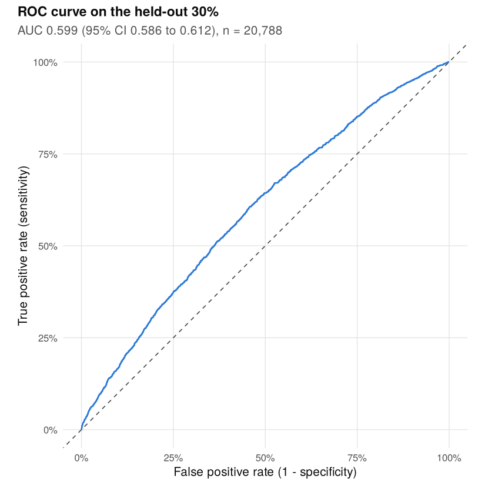
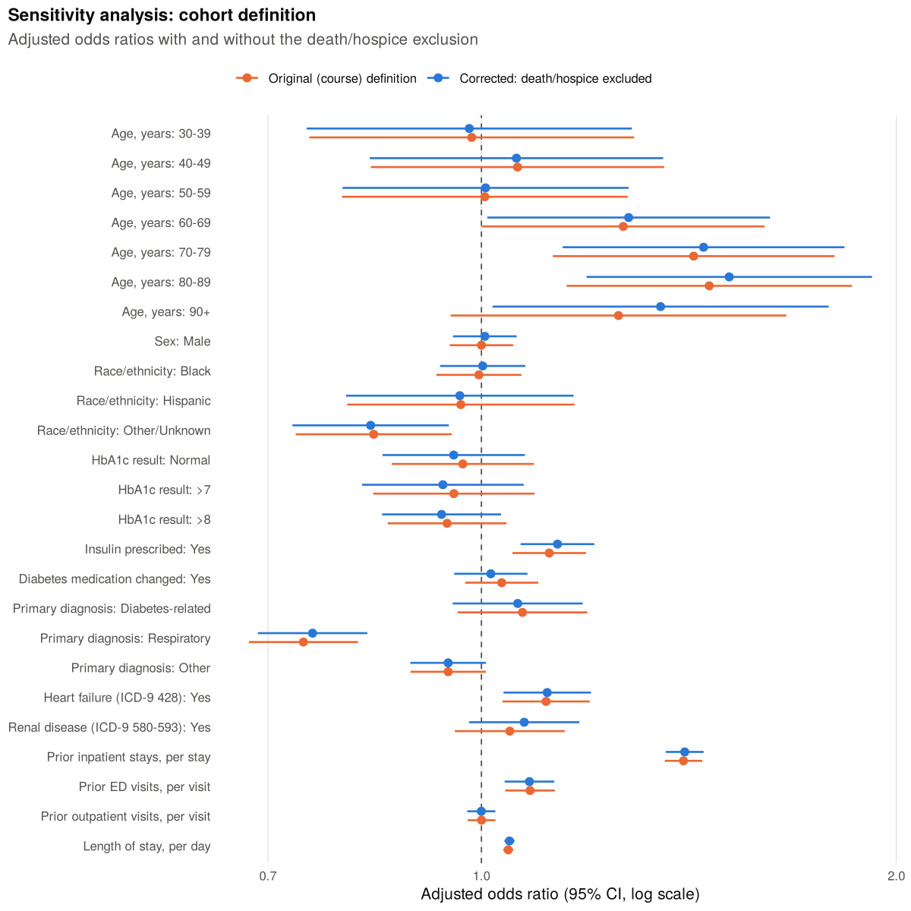

30-day readmission among adults hospitalized with diabetes
================
Richard Mali and Vivian Asare

- [1. Cohort](#1-cohort)
- [2. Table 1: characteristics by readmission
  status](#2-table-1-characteristics-by-readmission-status)
- [3. Bivariate tests](#3-bivariate-tests)
- [4. Multivariable logistic
  regression](#4-multivariable-logistic-regression)
  - [Likelihood ratio tests](#likelihood-ratio-tests)
  - [Crude readmission rate by prior inpatient
    stays](#crude-readmission-rate-by-prior-inpatient-stays)
  - [Model checks](#model-checks)
- [5. Discrimination and calibration](#5-discrimination-and-calibration)
- [6. Sensitivity analysis: original cohort
  definition](#6-sensitivity-analysis-original-cohort-definition)
- [Session info](#session-info)

This notebook runs the full analysis. Functions live in `R/`; this file
calls them in order and writes every figure and table to `outputs/`.

## 1. Cohort

The source file has one row per inpatient encounter. The cohort keeps
adults, takes each patient’s first encounter as the index admission, and
removes index encounters that ended in death or discharge to hospice,
since those patients cannot be readmitted. Three patients with sex
recorded as Unknown/Invalid are dropped.

``` r
raw <- read_diabetes_data(file.path(root, "data", "diabetic_data.csv.gz"))
cohort <- build_cohort(raw, exclude_death_hospice = TRUE)
analytic <- recode_analytic(cohort$data)

write_table(cohort$flow, "cohort_flow")
knitr::kable(cohort$flow, format.args = list(big.mark = ","))
```

| step                             | n_remaining | excluded_reason               | n_excluded |
|:---------------------------------|------------:|:------------------------------|-----------:|
| All encounters                   |     101,766 |                               |            |
| Adult encounters (age 20+)       |     100,914 | Age under 20                  |        852 |
| First encounter per patient      |      70,840 | Repeat encounters             |     30,074 |
| Discharged alive, not to hospice |      69,297 | Died or discharged to hospice |      1,543 |
| Analytic cohort                  |      69,294 | Sex unknown or invalid        |          3 |


``` r
n_total <- nrow(analytic)
n_events <- sum(analytic$readmit_30day)
```

The analytic cohort has 69,294 patients, of whom 6,249 (9.0%) were
readmitted within 30 days.

## 2. Table 1: characteristics by readmission status

Column percentages within each group. The prior-visit counts have a
median of zero in both groups, so means are shown as well.

``` r
table1 <- make_table1(analytic)
write_table(table1, "table1")

table1 |>
  dplyr::mutate(characteristic = ifelse(duplicated(characteristic), "", characteristic)) |>
  dplyr::select(Characteristic = characteristic, Level = level, Statistic = statistic,
                Overall = overall, `Not readmitted` = not_readmitted,
                `Readmitted <30 days` = readmitted) |>
  knitr::kable()
```

| Characteristic                   | Level            | Statistic      | Overall       | Not readmitted | Readmitted \<30 days |
|:---------------------------------|:-----------------|:---------------|:--------------|:---------------|:---------------------|
| Age, years                       | 20-29            | n (%)          | 1,132 (1.6)   | 1,048 (1.7)    | 84 (1.3)             |
|                                  | 30-39            | n (%)          | 2,692 (3.9)   | 2,504 (4.0)    | 188 (3.0)            |
|                                  | 40-49            | n (%)          | 6,828 (9.9)   | 6,322 (10.0)   | 506 (8.1)            |
|                                  | 50-59            | n (%)          | 12,349 (17.8) | 11,470 (18.2)  | 879 (14.1)           |
|                                  | 60-69            | n (%)          | 15,683 (22.6) | 14,271 (22.6)  | 1,412 (22.6)         |
|                                  | 70-79            | n (%)          | 17,748 (25.6) | 15,931 (25.3)  | 1,817 (29.1)         |
|                                  | 80-89            | n (%)          | 11,102 (16.0) | 9,907 (15.7)   | 1,195 (19.1)         |
|                                  | 90+              | n (%)          | 1,760 (2.5)   | 1,592 (2.5)    | 168 (2.7)            |
| Sex                              | Female           | n (%)          | 36,853 (53.2) | 33,508 (53.1)  | 3,345 (53.5)         |
|                                  | Male             | n (%)          | 32,441 (46.8) | 29,537 (46.9)  | 2,904 (46.5)         |
| Race/ethnicity                   | White            | n (%)          | 51,835 (74.8) | 47,053 (74.6)  | 4,782 (76.5)         |
|                                  | Black            | n (%)          | 12,454 (18.0) | 11,369 (18.0)  | 1,085 (17.4)         |
|                                  | Hispanic         | n (%)          | 1,477 (2.1)   | 1,355 (2.1)    | 122 (2.0)            |
|                                  | Other/Unknown    | n (%)          | 3,528 (5.1)   | 3,268 (5.2)    | 260 (4.2)            |
| HbA1c result                     | Not measured     | n (%)          | 56,803 (82.0) | 51,624 (81.9)  | 5,179 (82.9)         |
|                                  | Normal           | n (%)          | 3,698 (5.3)   | 3,376 (5.4)    | 322 (5.2)            |
|                                  | \>7              | n (%)          | 2,854 (4.1)   | 2,608 (4.1)    | 246 (3.9)            |
|                                  | \>8              | n (%)          | 5,939 (8.6)   | 5,437 (8.6)    | 502 (8.0)            |
| Insulin prescribed               | No               | n (%)          | 34,148 (49.3) | 31,314 (49.7)  | 2,834 (45.4)         |
|                                  | Yes              | n (%)          | 35,146 (50.7) | 31,731 (50.3)  | 3,415 (54.6)         |
| Diabetes medication changed      | No               | n (%)          | 38,061 (54.9) | 34,773 (55.2)  | 3,288 (52.6)         |
|                                  | Yes              | n (%)          | 31,233 (45.1) | 28,272 (44.8)  | 2,961 (47.4)         |
| Primary diagnosis                | Cardiovascular   | n (%)          | 21,377 (30.8) | 19,311 (30.6)  | 2,066 (33.1)         |
|                                  | Diabetes-related | n (%)          | 5,239 (7.6)   | 4,731 (7.5)    | 508 (8.1)            |
|                                  | Respiratory      | n (%)          | 9,455 (13.6)  | 8,764 (13.9)   | 691 (11.1)           |
|                                  | Other            | n (%)          | 33,223 (47.9) | 30,239 (48.0)  | 2,984 (47.8)         |
| Heart failure (ICD-9 428)        | No               | n (%)          | 58,818 (84.9) | 53,718 (85.2)  | 5,100 (81.6)         |
|                                  | Yes              | n (%)          | 10,476 (15.1) | 9,327 (14.8)   | 1,149 (18.4)         |
| Renal disease (ICD-9 580-593)    | No               | n (%)          | 63,649 (91.9) | 57,970 (92.0)  | 5,679 (90.9)         |
|                                  | Yes              | n (%)          | 5,645 (8.1)   | 5,075 (8.0)    | 570 (9.1)            |
| Inpatient admissions, prior year |                  | median \[IQR\] | 0 \[0, 0\]    | 0 \[0, 0\]     | 0 \[0, 0\]           |
|                                  |                  | mean (SD)      | 0.18 (0.60)   | 0.16 (0.55)    | 0.37 (0.97)          |
| Emergency visits, prior year     |                  | median \[IQR\] | 0 \[0, 0\]    | 0 \[0, 0\]     | 0 \[0, 0\]           |
|                                  |                  | mean (SD)      | 0.10 (0.51)   | 0.10 (0.50)    | 0.15 (0.58)          |
| Outpatient visits, prior year    |                  | median \[IQR\] | 0 \[0, 0\]    | 0 \[0, 0\]     | 0 \[0, 0\]           |
|                                  |                  | mean (SD)      | 0.28 (1.07)   | 0.28 (1.07)    | 0.31 (1.05)          |
| Length of stay, days             |                  | median \[IQR\] | 4 \[2, 6\]    | 3 \[2, 6\]     | 4 \[2, 7\]           |
|                                  |                  | mean (SD)      | 4.29 (2.94)   | 4.24 (2.92)    | 4.81 (3.06)          |

## 3. Bivariate tests

Chi-square tests for categorical variables (Cramer’s V, or phi for 2 x 2
tables) and Mann-Whitney U tests for the skewed counts (rank-biserial r,
positive when the readmitted group is higher). All expected cell counts
are checked against the usual minimum of 5.

``` r
bivariate <- bivariate_tests(analytic)
write_table(bivariate, "bivariate_tests")
stopifnot(all(bivariate$min_expected[!is.na(bivariate$min_expected)] >= 5))

bivariate |>
  dplyr::transmute(Characteristic = characteristic, Test = test,
                   Statistic = round(statistic, 2), df,
                   `Effect size` = sprintf("%s = %.3f", effect_size_type, effect_size),
                   p = format_p(p_value)) |>
  knitr::kable()
```

| Characteristic                   | Test           |     Statistic |  df | Effect size             | p       |
|:---------------------------------|:---------------|--------------:|----:|:------------------------|:--------|
| Age, years                       | Chi-square     |        166.96 |   7 | Cramer’s V = 0.049      | \<0.001 |
| Sex                              | Chi-square     |          0.31 |   1 | phi = 0.002             | 0.576   |
| Race/ethnicity                   | Chi-square     |         16.86 |   3 | Cramer’s V = 0.016      | \<0.001 |
| HbA1c result                     | Chi-square     |          3.99 |   3 | Cramer’s V = 0.008      | 0.263   |
| Insulin prescribed               | Chi-square     |         42.24 |   1 | phi = 0.025             | \<0.001 |
| Diabetes medication changed      | Chi-square     |         14.71 |   1 | phi = 0.015             | \<0.001 |
| Primary diagnosis                | Chi-square     |         47.57 |   3 | Cramer’s V = 0.026      | \<0.001 |
| Heart failure (ICD-9 428)        | Chi-square     |         56.91 |   1 | phi = 0.029             | \<0.001 |
| Renal disease (ICD-9 580-593)    | Chi-square     |          8.58 |   1 | phi = 0.011             | 0.003   |
| Inpatient admissions, prior year | Mann-Whitney U | 215622192\.00 |     | rank-biserial r = 0.095 | \<0.001 |
| Emergency visits, prior year     | Mann-Whitney U | 202465974\.50 |     | rank-biserial r = 0.028 | \<0.001 |
| Outpatient visits, prior year    | Mann-Whitney U | 200553004\.00 |     | rank-biserial r = 0.018 | \<0.001 |
| Length of stay, days             | Mann-Whitney U | 220273586\.00 |     | rank-biserial r = 0.118 | \<0.001 |

## 4. Multivariable logistic regression

The model keeps the course specification: all 13 predictors entered
together, with counts and length of stay as linear terms.

``` r
model <- fit_readmission_model(analytic)
stopifnot(model$converged)
or_table <- odds_ratio_table(model)
write_table(or_table, "odds_ratios")

or_table |>
  dplyr::transmute(Characteristic = characteristic, Level = level,
                   Reference = reference,
                   `OR (95% CI)` = sprintf("%.2f (%.2f, %.2f)", or, conf_low, conf_high),
                   p = format_p(p_value)) |>
  knitr::kable()
```

| Characteristic                   | Level                | Reference      | OR (95% CI)       | p       |
|:---------------------------------|:---------------------|:---------------|:------------------|:--------|
| Age, years                       | 30-39                | 20-29          | 0.98 (0.75, 1.29) | 0.884   |
| Age, years                       | 40-49                | 20-29          | 1.06 (0.83, 1.35) | 0.640   |
| Age, years                       | 50-59                | 20-29          | 1.01 (0.79, 1.28) | 0.955   |
| Age, years                       | 60-69                | 20-29          | 1.28 (1.01, 1.62) | 0.041   |
| Age, years                       | 70-79                | 20-29          | 1.45 (1.15, 1.83) | 0.002   |
| Age, years                       | 80-89                | 20-29          | 1.51 (1.19, 1.92) | \<0.001 |
| Age, years                       | 90+                  | 20-29          | 1.35 (1.02, 1.79) | 0.037   |
| Sex                              | Male                 | Female         | 1.01 (0.95, 1.06) | 0.833   |
| Race/ethnicity                   | Black                | White          | 1.00 (0.93, 1.08) | 0.954   |
| Race/ethnicity                   | Hispanic             | White          | 0.96 (0.80, 1.17) | 0.710   |
| Race/ethnicity                   | Other/Unknown        | White          | 0.83 (0.73, 0.95) | 0.005   |
| HbA1c result                     | Normal               | Not measured   | 0.95 (0.85, 1.08) | 0.446   |
| HbA1c result                     | \>7                  | Not measured   | 0.94 (0.82, 1.07) | 0.350   |
| HbA1c result                     | \>8                  | Not measured   | 0.94 (0.85, 1.03) | 0.189   |
| Insulin prescribed               | Yes                  | No             | 1.14 (1.07, 1.21) | \<0.001 |
| Diabetes medication changed      | Yes                  | No             | 1.02 (0.96, 1.08) | 0.615   |
| Primary diagnosis                | Diabetes-related     | Cardiovascular | 1.06 (0.95, 1.18) | 0.274   |
| Primary diagnosis                | Respiratory          | Cardiovascular | 0.75 (0.69, 0.83) | \<0.001 |
| Primary diagnosis                | Other                | Cardiovascular | 0.95 (0.89, 1.01) | 0.085   |
| Heart failure (ICD-9 428)        | Yes                  | No             | 1.12 (1.04, 1.20) | 0.003   |
| Renal disease (ICD-9 580-593)    | Yes                  | No             | 1.07 (0.98, 1.18) | 0.129   |
| Inpatient admissions, prior year | Per additional stay  |                | 1.40 (1.36, 1.45) | \<0.001 |
| Emergency visits, prior year     | Per additional visit |                | 1.08 (1.04, 1.13) | \<0.001 |
| Outpatient visits, prior year    | Per additional visit |                | 1.00 (0.98, 1.02) | 0.990   |
| Length of stay, days             | Per additional day   |                | 1.05 (1.04, 1.06) | \<0.001 |

<!-- -->

### Likelihood ratio tests

Each row compares the full model against the model without that
predictor, so multi-level factors get a single test.

``` r
lr <- lr_tests(model)
write_table(lr, "lr_tests")
lr |>
  dplyr::arrange(dplyr::desc(lr_chisq)) |>
  dplyr::transmute(Predictor = characteristic, df,
                   `LR chi-square` = round(lr_chisq, 1), p = format_p(p_value)) |>
  knitr::kable()
```

| Predictor                        |  df | LR chi-square | p       |
|:---------------------------------|----:|--------------:|:--------|
| Inpatient admissions, prior year |   1 |         394.1 | \<0.001 |
| Age, years                       |   7 |         124.0 | \<0.001 |
| Length of stay, days             |   1 |         112.0 | \<0.001 |
| Primary diagnosis                |   3 |          45.3 | \<0.001 |
| Insulin prescribed               |   1 |          16.3 | \<0.001 |
| Emergency visits, prior year     |   1 |          14.2 | \<0.001 |
| Heart failure (ICD-9 428)        |   1 |           8.6 | 0.003   |
| Race/ethnicity                   |   3 |           8.3 | 0.040   |
| HbA1c result                     |   3 |           2.8 | 0.416   |
| Renal disease (ICD-9 580-593)    |   1 |           2.3 | 0.132   |
| Diabetes medication changed      |   1 |           0.3 | 0.615   |
| Sex                              |   1 |           0.0 | 0.833   |
| Outpatient visits, prior year    |   1 |           0.0 | 0.990   |

### Crude readmission rate by prior inpatient stays

Prior inpatient use is the strongest predictor by LR chi-square. The
crude gradient shows what that looks like at the bedside.

``` r
prior_gradient <- analytic |>
  dplyr::mutate(prior_stays = ifelse(prior_inpatient >= 5, "5+",
                                     as.character(prior_inpatient))) |>
  dplyr::group_by(prior_stays) |>
  dplyr::summarise(patients = dplyr::n(), readmitted = sum(readmit_30day),
                   .groups = "drop") |>
  dplyr::mutate(share_of_cohort = patients / sum(patients),
                share_of_readmissions = readmitted / sum(readmitted),
                readmission_rate = readmitted / patients)
write_table(prior_gradient, "readmission_by_prior_inpatient")
knitr::kable(prior_gradient, digits = 3, format.args = list(big.mark = ","))
```

| prior_stays | patients | readmitted | share_of_cohort | share_of_readmissions | readmission_rate |
|:------------|---------:|-----------:|----------------:|----------------------:|-----------------:|
| 0           |   61,145 |      4,995 |           0.882 |                 0.799 |            0.082 |
| 1           |    5,765 |        742 |           0.083 |                 0.119 |            0.129 |
| 2           |    1,494 |        277 |           0.022 |                 0.044 |            0.185 |
| 3           |      460 |        110 |           0.007 |                 0.018 |            0.239 |
| 4           |      229 |         54 |           0.003 |                 0.009 |            0.236 |
| 5+          |      201 |         71 |           0.003 |                 0.011 |            0.353 |

### Model checks

Generalized VIF (adjusted values above about 3.2 would be a concern) and
the Box-Tidwell style linearity check from the course version.

``` r
vif <- vif_table(model)
write_table(vif, "vif")
knitr::kable(vif |> dplyr::select(-variable), digits = 2)
```

| characteristic                   | gvif |  df | gvif_adjusted |
|:---------------------------------|-----:|----:|--------------:|
| Age, years                       | 1.17 |   7 |          1.01 |
| Sex                              | 1.03 |   1 |          1.01 |
| Race/ethnicity                   | 1.06 |   3 |          1.01 |
| HbA1c result                     | 1.07 |   3 |          1.01 |
| Insulin prescribed               | 1.37 |   1 |          1.17 |
| Diabetes medication changed      | 1.36 |   1 |          1.17 |
| Primary diagnosis                | 1.23 |   3 |          1.03 |
| Heart failure (ICD-9 428)        | 1.14 |   1 |          1.07 |
| Renal disease (ICD-9 580-593)    | 1.01 |   1 |          1.01 |
| Inpatient admissions, prior year | 1.05 |   1 |          1.02 |
| Emergency visits, prior year     | 1.04 |   1 |          1.02 |
| Outpatient visits, prior year    | 1.02 |   1 |          1.01 |
| Length of stay, days             | 1.05 |   1 |          1.03 |

``` r
box_tidwell <- box_tidwell_check(analytic)
write_table(box_tidwell, "box_tidwell")
knitr::kable(box_tidwell |> dplyr::mutate(p = format_p(p_value)) |>
               dplyr::select(characteristic, estimate, p), digits = 3)
```

| characteristic                   | estimate | p       |
|:---------------------------------|---------:|:--------|
| Inpatient admissions, prior year |   -0.137 | \<0.001 |
| Emergency visits, prior year     |   -0.077 | 0.015   |
| Outpatient visits, prior year    |   -0.034 | 0.063   |
| Length of stay, days             |   -0.085 | \<0.001 |

## 5. Discrimination and calibration

Two complementary checks. First, a stratified 70/30 split: the model is
fit on 70% of patients and scored on the other 30%, which gives an
honest ROC curve and calibration plot. Second, Harrell’s bootstrap
optimism correction (200 resamples) on the full cohort, which uses all
the data for both fitting and validation.

``` r
holdout <- holdout_validation(analytic, train_prop = 0.7, seed = params$seed)
write_table(holdout$summary, "holdout_performance")
write_table(holdout$bins, "calibration_bins")
knitr::kable(holdout$summary, digits = 3)
```

| metric                         |  value |
|:-------------------------------|-------:|
| AUC                            |  0.599 |
| AUC 95% CI lower               |  0.586 |
| AUC 95% CI upper               |  0.612 |
| Calibration intercept          | -0.005 |
| Calibration slope              |  0.828 |
| Calibration slope 95% CI lower |  0.719 |
| Calibration slope 95% CI upper |  0.937 |
| Brier score                    |  0.081 |
| Observed rate                  |  0.090 |
| Mean predicted risk            |  0.091 |



``` r
boot <- bootstrap_optimism(analytic, B = params$boot_reps, seed = params$seed)
write_table(boot, "bootstrap_optimism")
knitr::kable(boot, digits = 4)
```

| metric                | apparent | mean_optimism | corrected | bootstrap_reps |
|:----------------------|---------:|--------------:|----------:|---------------:|
| AUC                   |   0.6087 |        0.0035 |    0.6052 |            200 |
| Calibration intercept |   0.0000 |       -0.0003 |    0.0003 |            200 |
| Calibration slope     |   1.0000 |        0.0255 |    0.9745 |            200 |
| Brier score           |   0.0809 |       -0.0001 |    0.0810 |            200 |

## 6. Sensitivity analysis: original cohort definition

The course version did not remove index encounters that ended in death
or hospice discharge. Here the same model is refit on that original
cohort and compared with the corrected one.

``` r
original <- build_cohort(raw, exclude_death_hospice = FALSE)
original_analytic <- recode_analytic(original$data)
original_model <- fit_readmission_model(original_analytic)

cohort_summary <- function(label, data, fit) {
  tibble::tibble(
    cohort = label,
    n = nrow(data),
    readmitted = sum(data$readmit_30day),
    rate = mean(data$readmit_30day),
    apparent_auc = auc_rank(data$readmit_30day, stats::fitted(fit))
  )
}
sensitivity_summary <- dplyr::bind_rows(
  cohort_summary(COHORT_ORIGINAL, original_analytic, original_model),
  cohort_summary(COHORT_CORRECTED, analytic, model)
)
write_table(sensitivity_summary, "sensitivity_summary")
knitr::kable(sensitivity_summary, digits = 4, format.args = list(big.mark = ","))
```

| cohort                            |      n | readmitted |   rate | apparent_auc |
|:----------------------------------|-------:|-----------:|-------:|-------------:|
| Original (course) definition      | 70,837 |      6,265 | 0.0884 |       0.6061 |
| Corrected: death/hospice excluded | 69,294 |      6,249 | 0.0902 |       0.6087 |

``` r
or_compare <- dplyr::bind_rows(
  dplyr::mutate(odds_ratio_table(original_model), cohort = COHORT_ORIGINAL),
  dplyr::mutate(or_table, cohort = COHORT_CORRECTED)
)
write_table(or_compare, "sensitivity_odds_ratios")

or_compare |>
  dplyr::select(characteristic, level, cohort, or) |>
  tidyr::pivot_wider(names_from = cohort, values_from = or) |>
  dplyr::mutate(`Ratio of ORs` = `Corrected: death/hospice excluded` /
                  `Original (course) definition`) |>
  knitr::kable(digits = 3)
```

| characteristic                   | level                | Original (course) definition | Corrected: death/hospice excluded | Ratio of ORs |
|:---------------------------------|:---------------------|-----------------------------:|----------------------------------:|-------------:|
| Age, years                       | 30-39                |                        0.984 |                             0.980 |        0.996 |
| Age, years                       | 40-49                |                        1.062 |                             1.060 |        0.998 |
| Age, years                       | 50-59                |                        1.006 |                             1.007 |        1.001 |
| Age, years                       | 60-69                |                        1.267 |                             1.279 |        1.009 |
| Age, years                       | 70-79                |                        1.426 |                             1.449 |        1.017 |
| Age, years                       | 80-89                |                        1.463 |                             1.513 |        1.034 |
| Age, years                       | 90+                  |                        1.257 |                             1.349 |        1.073 |
| Sex                              | Male                 |                        1.000 |                             1.006 |        1.006 |
| Race/ethnicity                   | Black                |                        0.996 |                             1.002 |        1.006 |
| Race/ethnicity                   | Hispanic             |                        0.966 |                             0.965 |        0.998 |
| Race/ethnicity                   | Other/Unknown        |                        0.835 |                             0.831 |        0.995 |
| HbA1c result                     | Normal               |                        0.969 |                             0.955 |        0.985 |
| HbA1c result                     | \>7                  |                        0.955 |                             0.938 |        0.982 |
| HbA1c result                     | \>8                  |                        0.944 |                             0.936 |        0.991 |
| Insulin prescribed               | Yes                  |                        1.120 |                             1.136 |        1.014 |
| Diabetes medication changed      | Yes                  |                        1.034 |                             1.016 |        0.982 |
| Primary diagnosis                | Diabetes-related     |                        1.071 |                             1.062 |        0.992 |
| Primary diagnosis                | Respiratory          |                        0.743 |                             0.754 |        1.015 |
| Primary diagnosis                | Other                |                        0.946 |                             0.946 |        1.000 |
| Heart failure (ICD-9 428)        | Yes                  |                        1.114 |                             1.116 |        1.002 |
| Renal disease (ICD-9 580-593)    | Yes                  |                        1.049 |                             1.074 |        1.024 |
| Inpatient admissions, prior year | Per additional stay  |                        1.401 |                             1.404 |        1.002 |
| Emergency visits, prior year     | Per additional visit |                        1.085 |                             1.084 |        0.999 |
| Outpatient visits, prior year    | Per additional visit |                        1.000 |                             1.000 |        1.000 |
| Length of stay, days             | Per additional day   |                        1.046 |                             1.048 |        1.002 |

Who did the exclusion remove? Share of first adult encounters (sex
known) that ended in death or hospice discharge, by age band:

``` r
excluded_by_age <- original$data |>
  dplyr::mutate(age = format_age_band(age),
                death_or_hospice = is_death_or_hospice(discharge_disposition_id)) |>
  dplyr::group_by(age) |>
  dplyr::summarise(patients = dplyr::n(), excluded = sum(death_or_hospice),
                   share_excluded = mean(death_or_hospice), .groups = "drop")
write_table(excluded_by_age, "death_hospice_by_age")
knitr::kable(excluded_by_age, digits = 3, format.args = list(big.mark = ","))
```

| age   | patients | excluded | share_excluded |
|:------|---------:|---------:|---------------:|
| 20-29 |    1,138 |        6 |          0.005 |
| 30-39 |    2,699 |        7 |          0.003 |
| 40-49 |    6,878 |       50 |          0.007 |
| 50-59 |   12,466 |      117 |          0.009 |
| 60-69 |   15,959 |      276 |          0.017 |
| 70-79 |   18,208 |      460 |          0.025 |
| 80-89 |   11,589 |      487 |          0.042 |
| 90+   |    1,900 |      140 |          0.074 |

<!-- -->

## Session info

``` r
sessionInfo()
```

    ## R version 4.3.3 (2024-02-29)
    ## Platform: x86_64-pc-linux-gnu (64-bit)
    ## Running under: Ubuntu 24.04.5 LTS
    ## 
    ## Matrix products: default
    ## BLAS:   /usr/lib/x86_64-linux-gnu/blas/libblas.so.3.12.0 
    ## LAPACK: /usr/lib/x86_64-linux-gnu/lapack/liblapack.so.3.12.0
    ## 
    ## locale:
    ## [1] C
    ## 
    ## time zone: America/Chicago
    ## tzcode source: system (glibc)
    ## 
    ## attached base packages:
    ## [1] stats     graphics  grDevices utils     datasets  methods   base     
    ## 
    ## loaded via a namespace (and not attached):
    ##  [1] bit_4.0.5        gtable_0.3.4     dplyr_1.1.4      compiler_4.3.3  
    ##  [5] highr_0.10       crayon_1.5.2     Rcpp_1.0.12      tidyselect_1.2.0
    ##  [9] parallel_4.3.3   tidyr_1.3.1      scales_1.3.0     yaml_2.3.8      
    ## [13] fastmap_1.1.1    plyr_1.8.9       ggplot2_3.4.4    readr_2.1.5     
    ## [17] R6_2.5.1         labeling_0.4.3   generics_0.1.3   knitr_1.45      
    ## [21] backports_1.4.1  tibble_3.2.1     car_3.1-2        pROC_1.18.5     
    ## [25] munsell_0.5.0    pillar_1.9.0     tzdb_0.4.0       rlang_1.1.3     
    ## [29] utf8_1.2.4       broom_1.0.5      xfun_0.41        bit64_4.0.5     
    ## [33] cli_3.6.2        withr_2.5.0      magrittr_2.0.3   digest_0.6.34   
    ## [37] grid_4.3.3       vroom_1.6.5      hms_1.1.3        lifecycle_1.0.4 
    ## [41] vctrs_0.6.5      evaluate_0.23    glue_1.7.0       farver_2.1.1    
    ## [45] abind_1.4-5      carData_3.0-5    fansi_1.0.5      colorspace_2.1-0
    ## [49] purrr_1.0.2      rmarkdown_2.25   tools_4.3.3      pkgconfig_2.0.3 
    ## [53] htmltools_0.5.7
